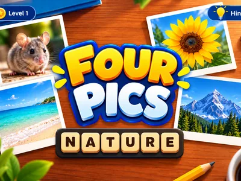
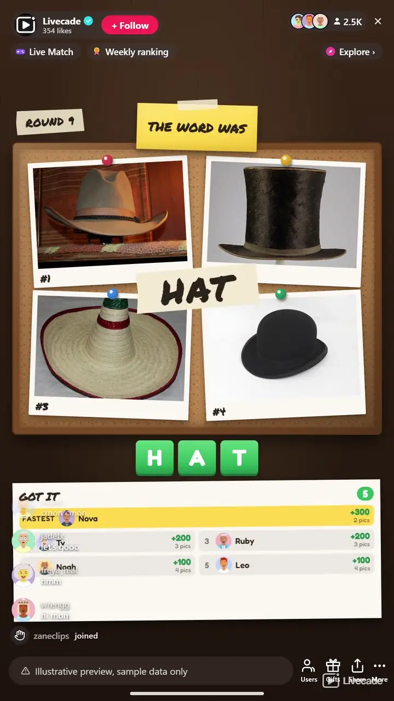

# Four Pics - Interactive TikTok Live Game

> Four photos, one word. Type it in chat before the last photo turns over.

A live picture-word race for your whole chat. Four photos flip over one at a time, all sharing one word, and viewers type it in chat. The fewer photos they needed, the more they score.

**[Play Four Pics on Livecade](https://livecade.io/games/four-pics/?utm_source=github&utm_medium=readme&utm_campaign=four-pics)** - runs as a single browser source in OBS, Streamlabs, or TikTok LIVE Studio. Nothing for viewers to install.

## How viewers play

Viewers take part with the actions TikTok already gives them: **comments**, **gifts**. Every action below is rebindable, so you decide which interaction drives which effect.

| Action | What it does |
| --- | --- |
| **Reveal a letter** | Fills in one hidden letter of the word for everyone and names the sender on screen, capped so most of the word stays hidden |

## How it works

### Type the word in chat

Four photos flip over one at a time and they all share one word. Viewers type it in chat, and everyone who gets it scores once per puzzle.

### Fewer photos, more points

The points drop as each photo turns over: 400 with one photo showing, then 300, 200 and 100. A session leaderboard adds them up across every puzzle.

### Gifts reveal a letter

A gift fills in one hidden letter for everyone and names the gifter on screen. It stops at 40% of the word, so the answer still has to be typed.

### Loops on its own

After the reveal the board clears and the next puzzle starts by itself, so you can go live and let it run.

## About the game

Four Pics pins four photos face down on a cork board on your stream. They flip over one at a time, all four share one word, and viewers race to type it in chat. Solve it from the first photo and it is worth 400 points; wait for all four and it is 100. The reveal tapes the word across the board and lists everyone who got it, fastest first.

### 784 puzzles in thirteen languages

Every puzzle is four real photos and one word, sorted into easy, medium and hard: 784 in English and more than 500 in each of the other twelve languages. Each language has its own answers, so a Spanish stream plays in Spanish and an English answer does not count there. Puzzles come up least recently shown first, so your regulars do not see a repeat until the bank has gone round.

### Runs itself, with you in control

Rounds roll on their own, and a match can run all stream or end after a set number of puzzles or a target score, with a podium for the top three. From the host controls you can pin a How to play card over the board, give chat a free letter, flip the next photo early or skip a puzzle.

## What it looks like on stream

[Watch Four Pics gameplay](https://cdn.livecade.io/games/four-pics.mp4)

## What you can configure

- **Language** - Thirteen languages. Only answers in the stream's language count
- **Difficulty** - Mixed, or only easy, medium or hard puzzles
- **Photo timing** - Seconds between photos, how long the last photo stays up, and how long the answer shows
- **Match ends** - Never, after a number of puzzles, or when someone reaches a score
- **Leaderboard** - Show the top players, three to five entries
- **Background image** - Your own image or GIF behind the board
- **Who can play** - Everyone, followers only, or your fans club only. Applies to comments and gifts

## Languages

English, Spanish, Portuguese, French, German, Italian, Indonesian, Arabic, Turkish, Russian, Hindi, Romanian, Filipino

## FAQ

<strong>How do viewers play Four Pics?</strong>

Viewers type the one word the four photos share in your TikTok Live chat. The fewer photos were showing when they answered, the more they score: 400, 300, 200 or 100.

<strong>Do viewers need to send gifts to play?</strong>

No. Guessing is free. A gift reveals one letter for everyone, capped at 40% of the word, so gifting helps the room without buying the win.

<strong>Do English answers count on a non-English stream?</strong>

No. Only the stream's language counts, so a Spanish stream plays fully in Spanish. Accents are optional, so a word typed on a phone without them still matches.

<strong>Do the puzzles repeat?</strong>

Not until the bank has gone round. Puzzles come up least recently shown first for your channel, so regulars keep getting new ones.

<strong>How do I add Four Pics to my TikTok Live?</strong>

Add one browser source URL to OBS or your streaming software and go live. There is no plugin to install and nothing for your viewers to download.

## Setup

1. [Create a Livecade account](https://app.livecade.io/register?utm_source=github&utm_medium=cta&utm_campaign=four-pics)
2. Copy your overlay browser source URL
3. Paste it into OBS, Streamlabs, or TikTok LIVE Studio
4. Pick Four Pics, set your triggers, and go live

Runs in the browser, so it works on Windows and macOS with nothing to download. [See all TikTok Live games](https://livecade.io/tiktok-live-games/?utm_source=github&utm_medium=readme&utm_campaign=four-pics).

---

_This repository documents Four Pics, a hosted interactive game by [Livecade](https://livecade.io/?utm_source=github&utm_medium=footer&utm_campaign=four-pics). The game runs on Livecade's platform, so there is no source to install here._
